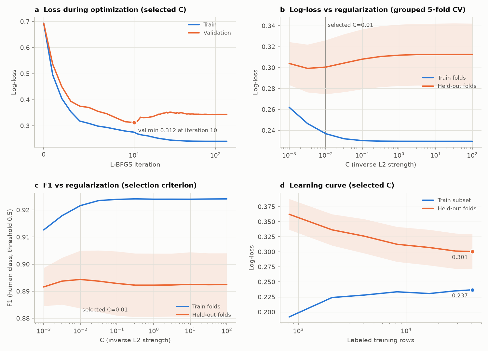
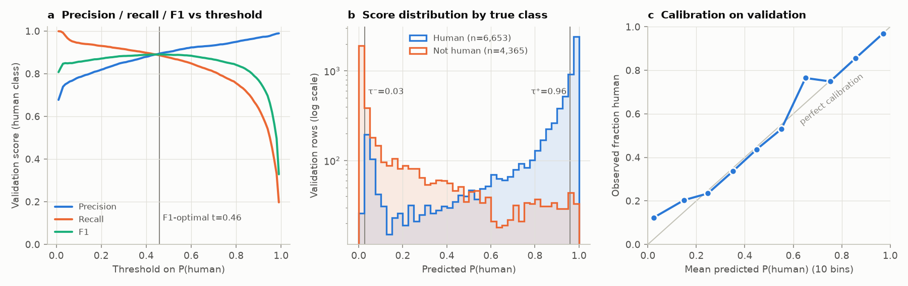

# Stage 1 report: supervised baseline (human vs not-human host)

*2026-09-29 · code at commit `809fe7c` · config `configs/pipeline.yaml` · full metrics in `stage1_metrics.json`*

## Summary

- An L2 logistic regression on frozen PubMedBERT embeddings of the BioSample free-text fields reaches **validation
  F1 = 0.889** (precision 0.902, recall 0.876) for the human class at threshold 0.5. Grouped 5-fold CV on the
  training set gives F1 0.894 ± 0.011. Predicting "human" for everything scores F1 0.753.
- Almost all of the signal is **implicit**. Only 3% of validation texts contain "human", "patient" or "homo sapiens";
  a keyword rule finds just 4.7% of human samples. The model gets F1 0.887 on the other 97%.
- Training is stable and the model is **capacity-limited, not data-limited**. Regularization barely matters, and the
  learning curve has flattened: going from 16k to 41k training rows adds only +0.003 F1.
- The worst errors come from **label noise**. One template ("reactor sample N", labeled *Homo sapiens*) produces 200 of the 222
  confidently wrong validation predictions. About 85 samples whose host names are misspellings such as "Homosapiens" are labeled not-human.
- The test set has **not** been scored. By design (check L7), it is used once, in the stage 1 vs stage 2 comparison.

## Setup

- **Rows:** 51,406 training and 11,018 validation rows (60.4% human in each).
- **Split:** grouped so that near-duplicate texts and most BioProjects never span two splits; see `leakage_report.json`.
- **Input text:** `host_comments`, `isolation_comments` and `comments`, with placeholder values removed. It is embedded with
  `NeuML/pubmedbert-base-embeddings` (768 dimensions, mean pooling, unit-normalized).
- **Model:** `StandardScaler` followed by `LogisticRegression` (L2, L-BFGS), both inside one sklearn Pipeline.
- **Tuning:** C ∈ {10⁻³ … 10²} × class_weight ∈ {none, balanced}, chosen by F1 in 5-fold `StratifiedGroupKFold` on
  train. **Selected: C = 0.01, class_weight = none.**

| | Precision | Recall | F1 | Macro-F1 | AP | ROC-AUC | Log-loss |
|---|---|---|---|---|---|---|---|
| CV on train (mean of 5 folds) | 0.889 | 0.900 | **0.894** | – | 0.956 | – | 0.300 |
| Validation, threshold 0.50 | 0.902 | 0.876 | **0.889** | 0.863 | 0.953 | 0.934 | 0.344 |
| Validation, F1-optimal threshold 0.46 | 0.895 | 0.887 | 0.891 | 0.863 | | | |
| Validation without the "reactor" template (n = 10,696) | 0.902 | 0.920 | 0.911 | | 0.963 | 0.955 | 0.263 |
| *Baseline: always predict human* | 0.604 | 1.000 | 0.753 | 0.377 | | | |
| *Baseline: keyword rule (human / patient / homo sapiens)* | 0.937 | 0.047 | 0.089 | 0.333 | | | |

Validation confusion matrix at 0.5: 5,830 true positives, 632 false positives, 823 false negatives, 3,733 true negatives.

## Training process

- **(a) Optimization.** L-BFGS converges in 138 iterations. The trace re-runs sklearn's objective on its own and
  matches sklearn's fitted coefficients (correlation 0.9997). Training loss falls steadily from ln 2 = 0.693 to 0.241.
  Validation loss bottoms out at 0.312 (iteration 10), then *rises* to 0.344, while validation F1 keeps improving
  (0.878 → 0.889). So the model ranks rows better but grows over-confident on a minority of them. The error analysis
  below finds that minority: almost entirely one mislabeled template.
- **(b, c) Regularization.** Held-out F1 is flat across five orders of magnitude of C (0.892–0.894). Held-out log-loss is
  lowest at C ≈ 0.003–0.01. The train–CV gap is modest (F1 0.922 vs 0.894). With 41k rows against 769 parameters,
  the L2 penalty isn't what limits performance.
- **(d) Learning curve.** Held-out log-loss drops from 0.362 (822 rows) to 0.301 (41k rows), and F1 from 0.873 to
  0.894. Most of that gain comes by about 16k rows; after that, the curves run in parallel with a persistent gap. The
  limit is the linear model on frozen embeddings, not the amount of labeled data.

## Validation behaviour

- **(a)** Precision and recall cross near 0.46, and F1 stays between 0.883 and 0.891 for any threshold from 0.3 to
  0.6. So the choice of threshold matters little for F1.
- **(b)** Scores are strongly two-sided. At the precision targets planned for stage 2 (≥ 0.98 for each class), τ⁺ = 0.96
  covers 28.4% of validation rows and τ⁻ = 0.03 covers 18.4%. That's **47% of rows with confident labels**, so stage 2
  will have a large confident region to draw from.
- **(c)** Calibration is good from 0.2 to 1.0. The exception is the lowest bin: rows scored 0–0.1 have a mean score of
  0.024, but 12.3% are human. These are confidently wrong negatives.

**Slices (validation, threshold 0.46):**

| Slice | Share of val | F1 |
|---|---|---|
| Text names humans outright | 3% | 0.970 |
| Text doesn't name humans | 97% | 0.887 |
| `host_comments` present | 8% | 0.967 |
| `host_comments` absent | 92% | 0.882 |

The model's value lies almost entirely in reading indirect cues: specimen types (sputum, BAL, wound swab), hospital
names and clinical wording.

## Error analysis

1. **"Reactor sample N" (label noise).**
   - 370 samples from PRJNA606923 and PRJNA590676 have texts like "reactor sample273" and are labeled *Homo sapiens*.
   - Because they're near-duplicates, grouping put 322 of them in validation (2.9% of val).
   - They account for **200 of the 222** human samples scored below 0.05. Without them, validation F1 is 0.911 and
     log-loss 0.263.
   - The text gives no hint of a human host, so either the host label is wrong or the text can't recover it.
2. **Label-rule misses (label noise).** Host names such as "Homosapiens" (44 samples), "Homo_sapiens" (11), "Hom sapiens" (7),
   "Homosapien(s)/Homosapian" and "Human4…Human20" slip past the notebook's word-boundary regex. As a result, about 85
   samples are labeled not-human (70 train / 14 val / 7 test). The model already scores several of them above 0.95,
   which counts as a "false positive" today.
3. **Veterinary clinical specimens (a limit of text alone).** The remaining confident false positives are animal
   samples described in clinical language: "pus swabs", "urine (bladder puncture)", "surgical site infection",
   "swab hip joint" from dogs, pigs and horses. Nothing in the three fields names the host, so a text-only model can't
   separate them. This caps attainable precision.

## Implications for stage 2 (self-training)

- **Expected gain is small.** The learning curve is flat past about 16k rows, so adding about 40k pseudo-labeled texts of
  the same kind will probably move F1 by less than one CV standard deviation (±0.011). Section 6's paired bootstrap on
  the test set is needed to tell a real gain from noise.
- **Risk of reinforcing errors.** Confident but wrong clusters (like the reactor template) would be pseudo-labeled wrong
  and reinforced. Stage 2 should cap how many pseudo-labels each near-duplicate component of the pool can contribute,
  not only deduplicate exact texts.
- **Decisions needed before stage 2:**
  - (a) Widen the human host-name rule to catch the misspelled variants. This changes about 85 labels; if the set of
    labeled accessions stays the same, the frozen split can be reused.
  - (b) Check the reactor-sample BioSamples, and drop them if the host label is wrong.
